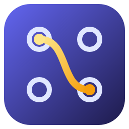
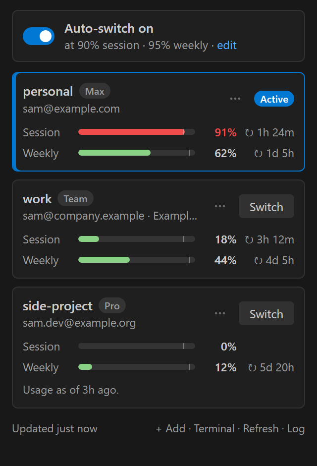

<div align="center">



# Switchboard

**Account switcher, task queues and prompt snippets for Claude Code in VS Code.**

[](https://github.com/JATQK/Switchboard/actions/workflows/ci.yml)
[](https://github.com/JATQK/Switchboard/releases/latest)
[](https://code.visualstudio.com/)
[](LICENSE)

[Features](#features) · [Install](#installation) · [Quick start](#quick-start) · [Usage](#usage) · [How it works](#how-it-works) · [Settings](#settings) · [Contributing](#contributing)

</div>

Switchboard keeps several Claude accounts side by side in VS Code. It shows each account's 5-hour session and 7-day weekly usage, and switches to another account before you hit a limit, either when you click or automatically. You can line up tasks in queues and let several Claude Code chats work through them, and keep the prompts you use often one click away.

<p align="center">
  
</p>

> **Note:** Switchboard is an independent community project. It is not affiliated with, endorsed by, or supported by Anthropic. "Claude" and "Claude Code" are trademarks of Anthropic. Switchboard is in **preview**, so details may change between releases.

## Features

| | |
|---|---|
| 📊 **Usage overview** | Session and weekly usage of every account, the time until each limit resets, and which account is active. |
| 🔀 **One-click switching** | Switch from the sidebar, the status bar, or `Switchboard: Switch Account…`. |
| ⚡ **Auto-switch** | When the active account reaches your threshold, new Claude Code sessions move to another account. Three strategies are available. |
| 🔗 **One shared setup** | All accounts share your settings, `CLAUDE.md`, skills, agents, commands, plugins and project history, so `claude --continue` picks up a conversation on another account. |
| 📋 **Queues** <sup>new</sup> | Line up tasks and let real Claude Code chats work through them, in an editor tab or the Claude Code panel. Several chats share a queue, and a chat can follow several queues one after another, keeping its context. |
| ✂️ **Snippets** <sup>new</sup> | Saved prompts with variables. Insert one into the chat, start a chat with it, queue it, or save it as a slash command. |
| 📎 **Copy from Claude Code** <sup>new</sup> | Copy the last answer, the last prompt, a resume command or a link in one step. |
| 🔒 **No credential handling** | Switchboard never reads, stores or sends your Claude login, and makes no network requests of its own. |

## Installation

**Requirements**

- VS Code **1.90** or later.
- Claude Code: either the [Claude Code extension](https://marketplace.visualstudio.com/items?itemName=anthropic.claude-code) or the `claude` CLI. Switchboard looks for `claude` on your `PATH`, in `~/.local/bin`, and inside the Claude Code extension.

**Install from a release**

1. Download `switchboard-accounts-X.Y.Z.vsix` from the [latest release](https://github.com/JATQK/Switchboard/releases/latest), under **Assets**.
2. Install it in one of these ways:
   - **Extensions view:** press `Ctrl+Shift+X` (`Cmd+Shift+X` on macOS), click **⋯** › **Install from VSIX…**, and pick the file.
   - **Command palette:** run **Extensions: Install from VSIX…**.
   - **Terminal:** `code --install-extension switchboard-accounts-X.Y.Z.vsix`
3. Reload VS Code if it asks. The **Switchboard** icon appears in the activity bar.

To update, install the newer `.vsix` the same way. It replaces the old version.

To build the `.vsix` yourself, see [Contributing](#contributing).

> **Upgrading from "Claude Switchboard" (`jatqk.claude-switchboard`, 0.2)?** That is a separate, older extension that switches accounts by swapping Claude Code's login. Uninstall it first, so the two don't switch accounts against each other. Then add your accounts again in Switchboard.

## Quick start

1. Open **Switchboard** in the activity bar. The account Claude Code already uses (`~/.claude`) appears as **Default**.
2. Click **Add an account…** and sign in with another Claude account. Claude Code's own `claude auth login` runs in a new terminal.
   *Tip:* if your browser is already signed in to claude.ai as someone else, sign out first or use a private window.
3. When the panel offers **Live usage**, turn it on. Claude Code terminal chats then report usage after every reply.
4. Click **Switch** on any account, or turn on **Auto-switch**.

That's it. New Claude Code sessions now use the selected account.

## Usage

The Switchboard sidebar has three views: **Accounts**, **Queues** and **Snippets**.

> **New here?** The [examples](examples/README.md) folder has illustrated workflows, best practices and a [starter set of snippets](examples/snippets.json).

### Accounts and switching

Each account card shows the plan, the email, session and weekly usage bars with your thresholds marked, and the time until each limit resets. The footer has links to add an account, open a terminal on the active account, refresh, and open the log.

Switching affects **new** Claude Code sessions: new VS Code terminals, new conversations in the Claude Code extension and, with the [shell setup](#terminals-outside-vs-code), new external shells. A chat that is already running keeps the account it started with, because Claude Code reads the account only when it starts.

**Moving running chats.** Each account card shows how many Claude Code chats run on that account. After a switch, Switchboard offers to move the chats that still run on the previous account (**Move to …** on the card, or `Switchboard: Move Running Chats to the Active Account`, does the same at any time). Moving a chat waits until it is idle, ends its Claude Code process, and continues the same conversation on the active account:

- **Panel chat:** continues with your next message, in the same tab.
- **Terminal chat:** continues in a new terminal (`claude --resume`).

A busy chat is moved once it finishes its turn. Background commands that the chat started end with it. Set `switchboard.moveChatsOnSwitch` to `always` to move chats without asking, or `never` to leave them alone.

Right-click an account card, or use its **⋯** button, to reorder, rename, log in again, show its folder, skip it in auto-switch, or remove it.

### Auto-switch

Turn auto-switch on in the panel, then pick thresholds and a strategy in [Settings](#settings).

| Strategy | Picks |
|---|---|
| `mostHeadroom` (default) | The account with the most capacity left. |
| `priority` | The first account in your list order that has capacity. Moves back up the list once a preferred account has reset. |
| `soonestWeeklyReset` | The account whose weekly limit resets soonest, as long as it has session capacity, so weekly quota that is about to expire gets used first. It moves there on its own once that account has clear session room (at least 10 points under the threshold) and its weekly limit resets at least an hour sooner. |

<details>
<summary><b>Safeguards</b></summary>

- It only switches away from an account when it has usage data for that account from the last 30 minutes.
- It never picks an account that is skipped or not logged in.
- It waits a cooldown between switches (5 minutes by default).
- After a manual switch, it won't switch again until a limit forces it.
- If every account is at its limit, it warns once and says when the next one resets.
- An account it has no usage data for yet is only tried as a last resort.
- All VS Code windows share the same active account and cooldown.

</details>

### Queues

A **queue** is a list of tasks, and **Claude Code chats** work through it on their own: each time Claude finishes a task in a chat, the chat starts on the next one, in the same conversation. When the queue is empty, the chat waits, and starts again as soon as you add a task. They are ordinary Claude Code chats, so you choose the model and permissions there as usual.

1. **Make a queue and add tasks.** Click **+ New queue**, then type a task and press **Add** (`Ctrl+Enter`). You can also add the selected text (editor context menu: **Add Task to a Queue…**) or a snippet. Waiting tasks can be edited, reordered and removed.
2. **Start chats.** **Start chats…** opens new chats for the queue, each with its own first task. Several chats share the queue's tasks, so they work in parallel.
   - **Claude Code in an editor tab** (fully automatic): each chat opens as a tab running Claude Code on the active account, with the model and permission mode you pick, starts on its first task, and keeps going.
   - **Claude Code panel:** each chat opens with its first task in the message box. Claude Code doesn't let extensions send panel messages, so press Enter there once. From then on, the chat keeps going on its own.
3. **Or add a chat you already have.** **Add a chat…** lets a chat that is running in this folder work on the queue. If the chat is idle, it starts on the next task by itself.
4. **Follow along.** Each task shows whether it is waiting, which chat is running it, and which chat finished it, with its answer (copy it, open it in an editor, or **Run again**). On the queue itself you can copy all answers as Markdown, clear finished tasks, rename or delete it. You get a notification when a queue is through.

**Chats and queues.** The **Chats** section lists every chat that works on queues: what it is doing, and the queues it follows, in order. When a chat runs out of tasks in one queue, it moves on to the next queue it follows and keeps its context, so you can reuse a chat across queues instead of starting a fresh one. Use **+ queue** to add a queue to a chat, ↑ to change the order, × to stop following a queue, and ⏸ to let a chat finish its current task without taking new ones.

<details>
<summary><b>How queues work</b></summary>

- While you use queues, Switchboard adds a Stop hook to Claude Code's `settings.json`. It asks you once before it does this the first time, and removes the hook when no queue needs it.
- The hook runs in the background after every turn (Claude Code's `asyncRewake`), so it never holds up a chat. In a chat that follows queues, it marks the chat's task as done, with Claude's last message as its answer. Then it waits until the chat is idle and a queue the chat follows has a task, and wakes Claude with that task. Each task is its own turn.
- The waiting stops when the chat ends, when you type in the chat (its next turn starts a new wait), or after a day. Chats that follow no queue wait half an hour, in case you add them to one. A chat you are talking to is never interrupted.
- Taking a task is an atomic file rename, so two chats never get the same task.
- Tasks that the hook hands over don't appear as messages in the chat. Claude starts its reply with a short line saying what it is working on, and the Queues view shows the task. The first task of a chat that Switchboard opens is a normal message; in panel chats it ends with a short marker such as `[queue: Docs · sb-…]`, which ties the new chat to its queue.
- Queues live in files under `~/.claude-switchboard/work/`, so chats keep working through them even when VS Code is closed.
- A chat keeps the account it started on. Switching accounts affects chats you start afterwards.
- On Windows, each waiting chat has a small PowerShell process that checks for tasks every 1.5 seconds.
- Queues need a [trusted workspace](https://code.visualstudio.com/docs/editor/workspace-trust), because they start and steer Claude Code in the folder.

</details>

### Snippets

The **Snippets** view keeps the prompts you use often. Click a snippet to insert it into the Claude Code chat in front. If no Claude Code chat is open, a new one starts with the snippet. Right-click a snippet to start a new chat with it, add it to a queue, copy, edit, rename, describe or delete it. **Switchboard: Use Snippet…** does the same from the command palette.

- **Create** a snippet from scratch, from the selected text (editor context menu), or from one of your recent prompts in this folder (**Save a Recent Prompt…**, read from Claude Code's conversation history).
- **Variables** are filled in when you use a snippet:

  | Variable | Becomes |
  |---|---|
  | `${selection}` | The text selected in the editor |
  | `${file}` | The path of the open file |
  | `${clipboard}` | The clipboard contents |
  | `${input:Question}` | A value you are asked for (each question is asked once) |

- **Save as Slash Command** writes the snippet to Claude Code's `commands` folder, so `/name` works in the Claude Code chat and in terminals, on every account. `${input:…}` becomes `$ARGUMENTS` (or `$1`, `$2`, … if there are several), so `/name your text` fills it in.
- Snippets are stored in `~/.claude-switchboard/snippets.json` and shared by all VS Code windows. **Open Snippets File** opens it.
- Inserting goes through the clipboard, which is restored afterwards, and only pastes when a Claude Code tab has focus. If text is selected in the editor, Claude Code also attaches that selection.

### Copy from Claude Code

**Switchboard: Copy from Claude Code…** (also in the Queues view's **⋯** menu) copies from the latest Claude Code conversation in the open folder, or from one you pick:

- its **last answer**,
- its **last prompt**,
- a **resume command** (`claude --resume <id>`),
- a **link** that opens it in Claude Code. VS Code asks once before a link may open Claude Code.

**Copy Last Claude Answer** and **Copy Last Claude Prompt** skip the menu, which makes them handy for keyboard shortcuts.

### Terminals outside VS Code

Run **Switchboard: Copy Shell Setup for External Terminals…** and paste the snippet into your `~/.bashrc`, `~/.zshrc` or PowerShell `$PROFILE`. New shells then start Claude Code with the account selected in Switchboard. Without it, external terminals keep using the default account.

## How it works

Each account is a **Claude Code config folder**, which Claude Code supports natively through the `CLAUDE_CONFIG_DIR` environment variable.

- **Default:** your existing setup (`~/.claude`, or wherever `CLAUDE_CONFIG_DIR` already points).
- **Added accounts:** folders under `~/.claude-switchboard/profiles/`. You sign in with Claude Code's own login inside that folder, and Claude Code keeps and refreshes the login there, as it always does.
- **Sharing:** settings, `CLAUDE.md`, skills, agents, commands, plugins, output styles, project history, file history, todos and IDE connection files are links back to your default folder. On Windows these are directory junctions and hard links, which need no admin rights.

To switch, Switchboard points new sessions at the chosen folder by setting `CLAUDE_CONFIG_DIR` for:

- new VS Code integrated terminals, through VS Code's terminal environment API;
- the Claude Code VS Code extension, by managing that one entry in its `claudeCode.environmentVariables` setting (you can turn this off);
- `~/.claude-switchboard/active-config-dir`, a plain-text file your shell profile can read.

**Where usage comes from**

- **Live usage (recommended):** after every reply in a terminal chat, Claude Code passes the current `rate_limits` to a [status line command](https://code.claude.com/docs/en/statusline). With live usage on, Switchboard installs a small status line script. The script saves that data into the account's folder and shows `5h 23% | 7d 41%` in Claude Code's status line. If you already have a status line, Switchboard asks before replacing it, and restores yours when you turn live usage off. Chats in the Claude Code panel don't run status lines, so they don't report usage this way.
- **Usage limits hit in a chat:** when a running chat hits its 5-hour or weekly limit, Claude Code records the rejection and its reset time in the chat's transcript. Switchboard reads this for the chats running on each account (from Claude Code's `sessions/` list in the account's folder), shows that limit as full until it resets, and auto-switch acts on it. This also covers panel chats.
- **Fallback:** the usage cache that Claude Code keeps in each account's `.claude.json`. Claude Code updates it only now and then, for example when a chat starts, so it can lag behind while panel chats are working. The card shows how old the numbers are.
- Login status, email and plan come from `claude auth status`.

### Privacy and security

- Switchboard does **not** read `.credentials.json` or the system keychain, and does not copy or refresh tokens.
- It does not call Anthropic's APIs, makes no network requests of its own, and sends **no telemetry**. Queued tasks run in your own Claude Code chats.
- Outside `~/.claude-switchboard/` and the account folders, it changes only: the `CLAUDE_CONFIG_DIR` entry in Claude Code's extension settings (can be turned off), the live usage status line (asks first, restores yours when turned off), the queue Stop hook (asks first, removed as soon as no queue needs it), and slash commands you save from snippets.

## Settings

| Setting | Default | Description |
|---|---|---|
| **Auto-switch** | | |
| `switchboard.autoSwitch.enabled` | `false` | Turn automatic switching on. |
| `switchboard.autoSwitch.sessionThreshold` | `90` | Switch away at this 5-hour session usage (%). |
| `switchboard.autoSwitch.weeklyThreshold` | `95` | Switch away at this weekly usage (%). |
| `switchboard.autoSwitch.strategy` | `mostHeadroom` | `mostHeadroom`, `priority` or `soonestWeeklyReset` (see [Auto-switch](#auto-switch)). |
| `switchboard.autoSwitch.cooldownMinutes` | `5` | Minimum time between switches. |
| `switchboard.autoSwitch.notify` | `true` | Notify when auto-switch acts. |
| `switchboard.moveChatsOnSwitch` | `ask` | After a switch: `ask` to offer moving chats that still run on the previous account, `always` to move them, `never` to leave them. |
| **General** | | |
| `switchboard.refreshIntervalSeconds` | `15` | How often local files are re-read. They are also watched for changes. |
| `switchboard.statusBar.enabled` | `true` | Show the active account in the VS Code status bar. |
| `switchboard.applyToClaudeCodeExtension` | `true` | Manage `CLAUDE_CONFIG_DIR` in `claudeCode.environmentVariables`. |
| `switchboard.shareConfig` | `true` | Link new accounts to your default setup. |
| `switchboard.claudePath` | | Path to `claude`. By default it is found on `PATH`, in `~/.local/bin`, or inside the Claude Code extension. |

## FAQ and known limitations

<details>
<summary><b>Why does my running chat still use the old account?</b></summary>

Claude Code reads the account when a chat starts, so a switch only reaches new chats. Use **Move** (offered after a switch, and on the old account's card) to continue a running chat on the new account. It continues the same conversation. Moving needs the two accounts to share history, which accounts that Switchboard adds do by default.
</details>

<details>
<summary><b>Which state is per account?</b></summary>

Each account has its own `.claude.json`, which holds onboarding, project trust prompts and user-level MCP servers. New accounts start with your MCP servers and theme copied from the default account. Later changes to these are not shared.
</details>

<details>
<summary><b>Why doesn't usage update while I work in the Claude Code panel?</b></summary>

Panel chats don't run Claude Code's status line, so Switchboard falls back to Claude Code's own usage cache, which updates only now and then; the card shows its age. A limit hit in a panel chat still shows up right away (see [Where usage comes from](#how-it-works)).
</details>

<details>
<summary><b>Why isn't live usage updating in one project?</b></summary>

If that project's `.claude/settings.json` defines its own `statusLine`, it overrides Switchboard's status line in that project.
</details>

<details>
<summary><b>Why is an inactive account's usage out of date?</b></summary>

An account's usage is as of its last session in Claude Code on this machine. Usage from claude.ai or other machines only shows up once the account is used here again.
</details>

<details>
<summary><b>Windows without Developer Mode</b></summary>

`settings.json` and `CLAUDE.md` are hard-linked. If a program replaces such a file instead of editing it, that account ends up with its own copy.
</details>

<details>
<summary><b>What happens when I remove an account?</b></summary>

**Remove from List** keeps its folder. **Log Out and Delete** runs `claude auth logout` for the account and deletes its folder. Shared content is never deleted, and the default account can't be removed.
</details>

<details>
<summary><b>Why do I have to press Enter in new panel chats?</b></summary>

Claude Code doesn't let other extensions send messages in its panel; they can only put text into the message box. So a new panel chat that Switchboard opens waits for your Enter on its first task, which also gives you the chance to pick the model and permissions. After that, it works through the queue on its own, including tasks you add later. To skip that Enter, start the chats as **Claude Code in an editor tab**: those start by themselves.
</details>

<details>
<summary><b>A terminal chat asks me to choose a theme</b></summary>

The first time Claude Code runs in a terminal for an account, it asks a few setup questions, such as a color theme. Answer them once and the chat starts on its first task. Until that is done, Switchboard starts only one terminal chat at a time.
</details>

<details>
<summary><b>How do I stop a chat in the middle of a queue?</b></summary>

Click ⏸ on the chat in the **Chats** section: it finishes its current task and takes no new ones. You can also stop Claude in the chat itself (Esc). Its task then stays "running"; use ↺ on the task to put it back in line.
</details>

<details>
<summary><b>Is using several accounts allowed?</b></summary>

Check that your use of several accounts fits Anthropic's terms for your plans. Switchboard only changes which of your own Claude Code logins new sessions use.
</details>

**Something not working?** Run **Switchboard: Show Log** and include its output when you [open an issue](https://github.com/JATQK/Switchboard/issues).

## Contributing

Bug reports, ideas and pull requests are welcome. Please [open an issue](https://github.com/JATQK/Switchboard/issues) before starting on a larger change, so we can agree on the approach first.

```sh
git clone https://github.com/JATQK/Switchboard
cd Switchboard
npm install
npm run lint              # type-check only
npm test                  # compile, then run unit and end-to-end tests (node:test)
npm run test:integration  # run the extension inside a real VS Code
npm run watch             # recompile on change; press F5 to start an Extension Development Host
npm run package           # build a .vsix
```

CI runs the tests on Windows, macOS and Linux, and the integration tests against the latest VS Code and the oldest supported version (1.90).

**Releases:** pushing a tag `vX.Y.Z` that matches `package.json` runs the tests, packages the extension, and publishes a GitHub Release with the `.vsix` attached. If the repository secrets `VSCE_PAT` and `OVSX_PAT` are set, the same workflow also publishes to the VS Code Marketplace and Open VSX. See the [changelog](CHANGELOG.md) for what changed in each version.

## License

[MIT](LICENSE) © JATQK
