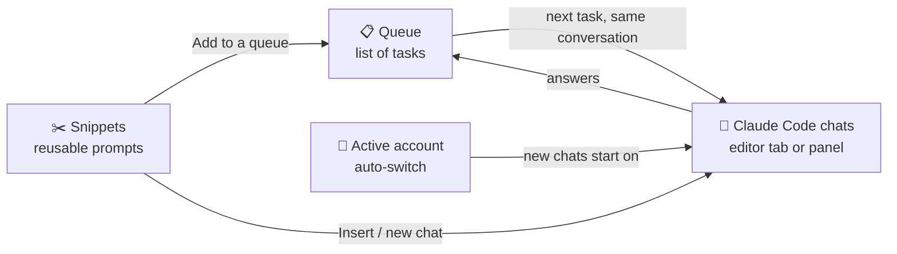

# Switchboard examples

Hands-on guides for getting the most out of Switchboard. Each guide has a picture of what happens, a step-by-step workflow you can copy, and the tips that make it work well.

| Guide | Use it when you want to… |
|---|---|
| [Accounts and auto-switch](accounts-and-auto-switch.md) | Keep working through a long day without hitting a 5-hour or weekly limit. |
| [Queues](queues.md) | Hand Claude Code a list of tasks and let one or more chats work through them. |
| [Snippets](snippets.md) | Reuse your best prompts, with variables, in one click or as slash commands. |
| [`snippets.json`](snippets.json) | Start with a set of ready-made snippets. |

## How the pieces fit together

- **Snippets** are where good prompts live.
- **Queues** turn a list of prompts into work that keeps going without you.
- **Accounts** make sure that work doesn't stop at a usage limit.

## Five habits that pay off

1. **Turn on Live usage.** Without it, usage numbers can lag. Auto-switch only acts on fresh data.
2. **Start queue chats in an editor tab.** They run fully on their own; panel chats need one Enter first.
3. **Write each queued task so it stands on its own.** Any chat sharing the queue may pick it up.
4. **Save a prompt as a snippet the second time you type it.** Use **Save a Recent Prompt…** so you don't retype it.
5. **Check the log first when something looks off.** Run **Switchboard: Show Log**.
