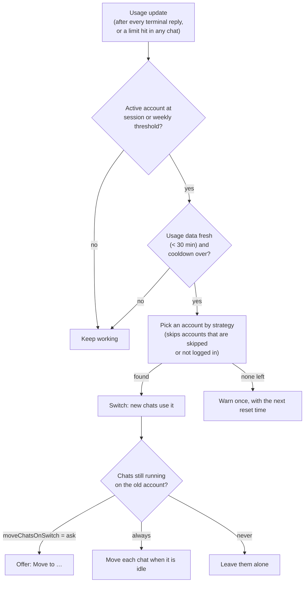

# Accounts and auto-switch

[← Examples](README.md)

## What the Accounts view tells you

```text
┌ ACCOUNTS ──────────────────────────────── ⟳  +  ⚙ ┐
│ Auto-switch ● on   session 90% · weekly 95%       │
│                                                   │
│ ▌Work            Max · active        2 chats      │
│   5h  ███████████████░░░░░│  78%   resets 1h 12m  │
│   7d  ████████░░░░░░░░░░░░│  41%   resets Thu     │
│                                                   │
│  Personal        Pro                   [Switch]   │
│   5h  ██░░░░░░░░░░░░░░░░░░│  10%   resets 3h 40m  │
│   7d  ███████████████████░│  93%   resets in 9h   │
│                                                   │
│  Default         Max     skipped in auto-switch   │
│   5h  ░░░░░░░░░░░░░░░░░░░░│   0%                  │
│   7d  ██████░░░░░░░░░░░░░░│  30%   resets Mon     │
└───────────────────────────────────────────────────┘
          │ = your threshold marker on each bar
```

- The **active** account is the one new Claude Code chats start on.
- **N chats** shows how many chats are still running on that account.
- If the numbers are older than a few minutes, the card shows their age. Turn on **Live usage** to keep them fresh.

## What happens when you hit a threshold



## Pick a strategy

| You have… | Use | Why |
|---|---|---|
| Accounts of similar size, no preference | `mostHeadroom` (default) | Spreads load. Always moves to the account with the most room. |
| One main account and backups | `priority` | Order the list with your main account on top. Switchboard falls back down the list and returns once your main account resets. |
| Accounts whose weekly limits reset on different days | `soonestWeeklyReset` | Uses quota that is about to expire first, so less of it goes to waste. |

## Workflow: a full working day on three accounts

1. **Add your accounts once.** Click **Add an account…**, sign in, and repeat for each account. Use a private browser window if claude.ai is signed in to a different account.
2. **Turn on Live usage** when the panel offers it.
3. **Set thresholds that leave room.** `90` for the session and `95` for the week work well. Use lower values if your tasks are long, because a chat can overshoot during one turn.
4. **Turn on Auto-switch.** Then work as usual.
5. **When it switches**, choose **Move to …** for chats you want to keep going. They continue the same conversation on the new account once they are idle.

## Tips

- **Use Skip in Auto-Switch, not Remove.** Right-click a card and choose **Skip in Auto-Switch** to keep an account (for example a shared team seat) out of automatic picks while you can still switch to it by hand.
- **External terminals** follow the active account only after you add the snippet from **Copy Shell Setup for External Terminals…** to your shell profile.
- **A project with its own `statusLine`** in `.claude/settings.json` hides Live usage in that project. Remove that `statusLine` or accept slower updates there.
- **Switching by hand pauses proactive switching** until a limit forces it. This way auto-switch never overrules a choice you just made.
- **`claude --continue` works across accounts** because all accounts share project history. This is an easy way to pick up where another account left off.
