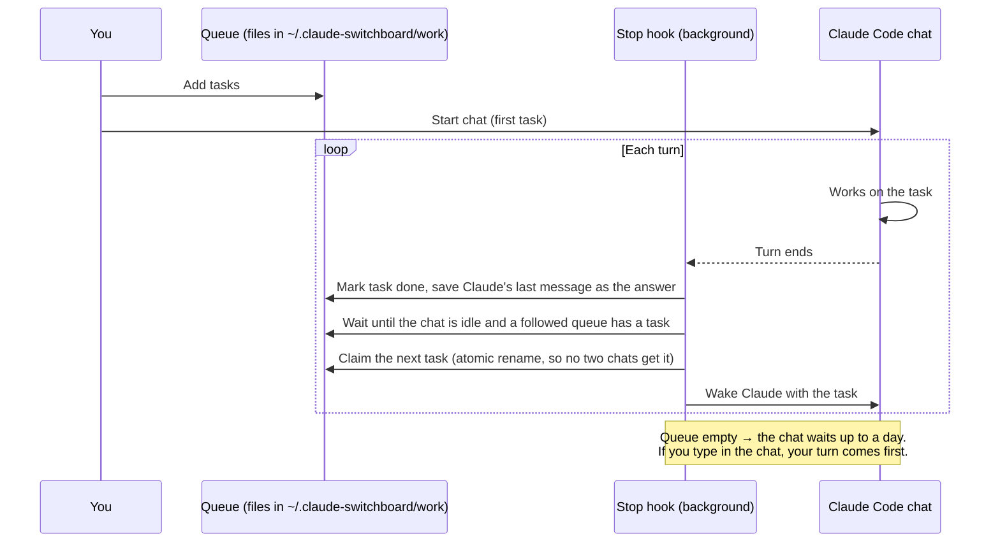
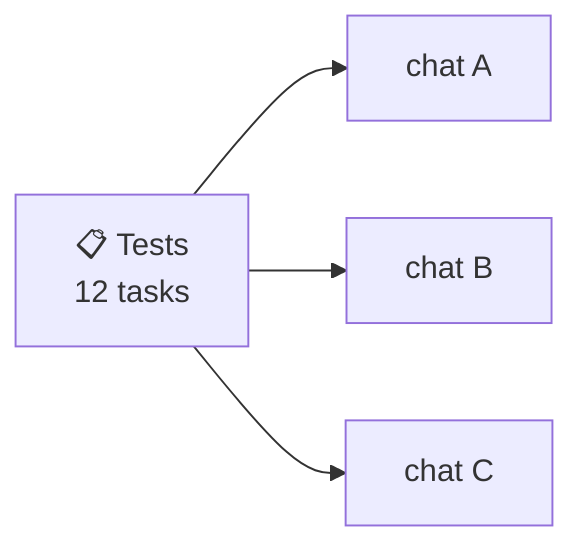
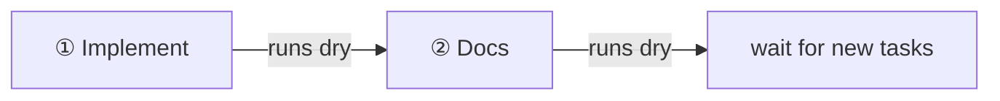

# Queues

[← Examples](README.md)

A queue is a list of tasks. Claude Code chats that **follow** the queue take one task per turn, in the same conversation, until the queue is empty. Then they wait for more.

## What the Queues view looks like

```text
┌ QUEUES ─────────────────────────────── +  ▶  ⋯ ┐
│ ▾ Refactor readme        2 waiting · 1 running │
│   ✓ Identify the framework          chat A  ⧉ ↗│
│   ● Streamline the README           chat A     │
│   ○ Add an examples folder              ↑ ↓ ✎ ×│
│   ○ Update the changelog                ↑ ↓ ✎ ×│
│   [ Type a task…                     ] [ Add ] │
│                                                │
│ CHATS                                          │
│   chat A  working: Streamline the README    ⏸ ×│
│      ① Refactor readme   ② Release notes ↑ ×   │
└────────────────────────────────────────────────┘
  ○ waiting   ● running   ✓ done (copy ⧉ / open ↗ the answer)
```

## How a chat moves from task to task



## Workflow 1: fan out independent work

You have many similar, independent tasks, such as "add tests for module X" once per module.

1. **+ New queue**, name it `Tests`.
2. Add one task per module. To add from code, select a list in the editor and choose **Add Task to a Queue…**.
3. **Start chats…** › **Claude Code in an editor tab** › **3** chats › model and permission mode (for example `acceptEdits`).
4. Watch the queue empty. When it is through, use the queue's copy button to get every answer as one Markdown report.



**Best practice:** chats take tasks in any order, so every task must make sense on its own. Name the file, the goal and what "done" means.

## Workflow 2: a pipeline that keeps context

You want one chat to implement something, then document it, without re-explaining the code.

1. Create two queues: `Implement` and `Docs`.
2. Start **one** chat on `Implement`.
3. In **Chats**, click **+ queue** on that chat and add `Docs`. It now follows `① Implement ② Docs`.
4. The chat finishes `Implement`, moves on to `Docs` in the same conversation, and still knows what it just built.



**Best practice:** for steps that build on each other, use one chat that follows queues in order. For independent steps, use several chats on one queue.

## Workflow 3: put an existing chat to work

You are already deep in a conversation and want it to handle a backlog next.

1. Fill a queue with the backlog.
2. **⋯** › **Let a Running Claude Code Chat Work on a Queue…** and pick the chat.
3. If the chat is idle, it starts right away. Otherwise it starts after its current turn.

## Writing good tasks

| ✗ Vague | ✓ Clear |
|---|---|
| Fix the tests | Make `npm test` pass. The failures are in `src/test/queues.test.ts`. Don't change test expectations. |
| Improve docs | Add a "Troubleshooting" section to `README.md` covering the three errors in `src/cli.ts`. Keep it under 20 lines. |
| Refactor | Split `src/queuesView.ts` into view and command files. No behaviour change. Run `npm run lint` at the end. |

- **One task, one outcome.** Smaller tasks give clearer answers and are easier to re-run with **Run again**.
- **Say how to check the result**, for example "run `npm test`", so Claude verifies its work within the turn.
- **Turn repeated tasks into snippets.** Then **Add Snippet to a Queue…** fills in `${input:…}` values each time. See [Snippets](snippets.md).

## Tips

- **Choose permissions on purpose.** `plan` is right for analysis queues, `acceptEdits` for routine edits, and `manual` when you want to approve each change.
- **Use ⏸ to stop gracefully.** The chat finishes its current task and takes no new ones. If you press Esc in the chat instead, the task stays "running"; click **↺** to put it back in line.
- **Queues survive VS Code closing.** Chats keep working through the files on disk.
- **Account limits:** each chat stays on the account it started with. Start new chats after a switch, or move chats over with **Move to …**.
- **The first terminal chat on an account** asks setup questions, such as a color theme. Answer them once. Until then Switchboard starts one terminal chat at a time.
