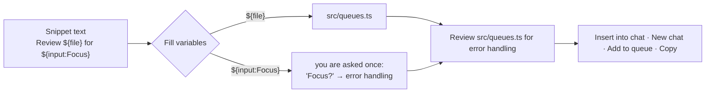

# Snippets

[← Examples](README.md)

## How a snippet becomes a prompt

| Variable | Becomes |
|---|---|
| `${selection}` | The text selected in the editor |
| `${file}` | The path of the open file |
| `${clipboard}` | The clipboard contents |
| `${input:Question}` | A value you are asked for. The same question is asked only once per use. |

## Start with a ready-made set

[`snippets.json`](snippets.json) contains a small set of tested snippets:

| Name | Use it for |
|---|---|
| Explain selection | Understanding unfamiliar code |
| Review file | A focused review of the open file |
| Write tests for selection | Unit tests that match the project's style |
| Fix from error | Pasting a stack trace from the clipboard |
| Commit message | A conventional commit message for staged changes |
| Plan before coding | A plan without edits, for larger changes |

**To use them:** run **Open Snippets File**, then copy the entries you want from `examples/snippets.json` into the `snippets` array. Keep each `id` unique. Don't paste over the whole file, or you will lose your own snippets.

## Workflow: from a one-off prompt to a slash command

1. You write a prompt that works well.
2. **Snippets** › **Save a Recent Prompt…** and pick it from this folder's history.
3. Replace the parts that change with variables, for example `${selection}` or `${input:Ticket}`.
4. Right-click › **Save as Slash Command**. `/name` now works in every chat and terminal, on every account. `${input:…}` becomes `$ARGUMENTS` (or `$1`, `$2`, … if there are several).

## Tips

- **Use a snippet as a queue template.** **Add Snippet to a Queue…** fills in the variables and queues the result. This is an easy way to queue the same kind of task for many files.
- **Use `${selection}` for code and `${clipboard}` for logs.** Stack traces and CI output are usually on the clipboard, not in an editor.
- **Phrase `${input:…}` questions as you want to be asked them**, for example `${input:Which module?}`.
- **Use the description field** (**Describe Snippet…**) to note when a snippet works best. It shows in the picker.
- **Snippets are one JSON file** (`~/.claude-switchboard/snippets.json`) shared by all VS Code windows. Back it up or sync it like any dotfile.
